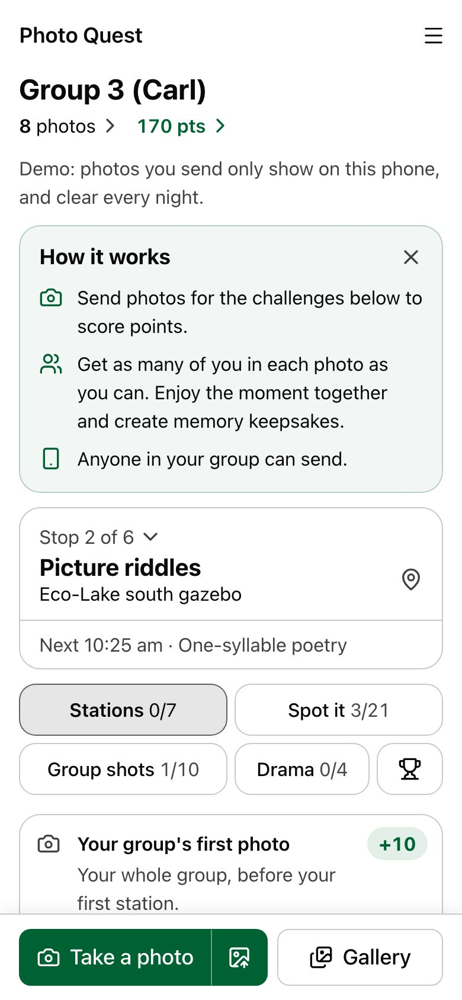
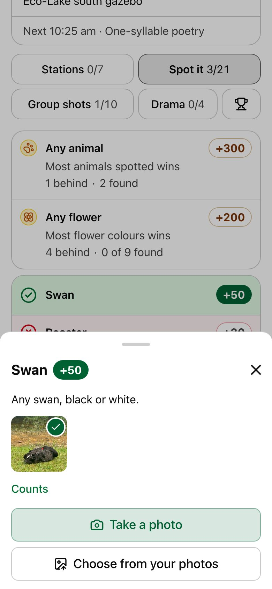
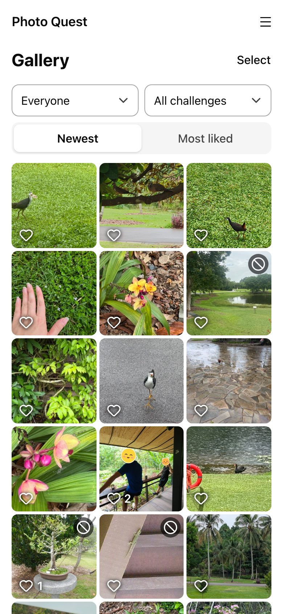
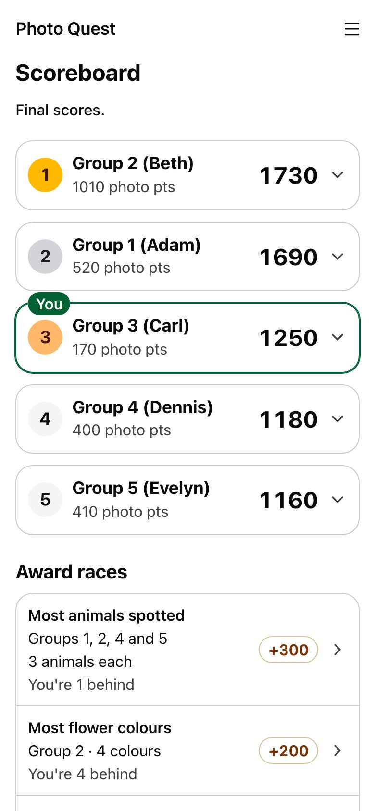

# Photo Quest

A phone web app for a group outing's photo challenges. Groups send photos for challenges, the committee judges them and enters station game scores, and everyone follows a live scoreboard and gallery.

**[Try the demo](https://photo-scavenger-hunt.samyipsh-work.workers.dev)** · **[See every screen](https://samyipsh.github.io/photo-scavenger-hunt/screens.html)**

<p>




</p>

The demo's committee passphrase is on its sign-in screen. Photos you send there show only on your phone, and the demo resets every night.

It was built for one church outing: one morning at the Singapore Botanic Gardens on Sat 14 Nov 2026, about 30 people in 5 groups. `data/` still holds that event, with made-up names, as a worked example.

**It's vibecoded.** AI agents wrote almost every line while the owner steered from a phone and never read the code. The architecture underneath came from the owner's earlier projects, not from the agents. `docs/how-it-was-built.md` has the time, the tokens, the mistakes and what that background was worth, and `docs/build-analytics.html` has the charts.

It's about 17,300 lines of TypeScript and Vue: 11,500 for the screens, 2,200 for the server, 1,100 of tests, and the rest shared rules, event data and scripts. On top of that are 1,100 lines of shadcn-vue components, copied in as that library intends.

Nuxt 4 single-page app on one Cloudflare Worker, with D1 for data and R2 for photos. Photos go from phones straight to R2 with signed links. `docs/tech-stack.md` lists what each part uses, and `docs/architecture.md` explains how it works, with diagrams.

## Photo sizes

The phone shrinks each photo before sending it: an album copy at most 2,048 px on its long side, and a 400 px thumbnail, both JPEG. It saves the album copy at quality 0.85, then tries 0.72 and 0.6 if it's still over 3 MB. The server refuses an album copy over 3 MB or a thumbnail over 400 KB. `app/utils/image.ts` and `shared/utils/photos.ts` hold the numbers.

At the outing, the 280 album copies averaged 1.0 MB. Half were under 980 KB, nine in ten under 1.7 MB, and the largest was 2.2 MB. Thumbnails measured 25 to 55 KB on staging. A photo straight from a phone camera is usually 3 to 6 MB as a JPEG ([SamMobile](https://www.sammobile.com/news/can-i-make-photos-use-less-storage-on-my-samsung-phone/), [TechRadar](https://www.techradar.com/phones/i-tested-the-best-iphone-and-galaxy-cameras-and-more-heres-why-200mp-is-overkill-and-which-setting-id-recommend-instead)), so the average album copy is a third to a sixth the size of a typical camera photo. iPhones store HEIC, which is smaller, but hand the browser a JPEG.

## Independent reviews

Claude Opus 5.5 and GPT-6.1 Sol (through Codex) each scored the repo twice, in fresh read-only sessions, against one frozen brief. Every score had to cite a file and line or a log line. **The same two model families wrote this code and reviewed its pull requests**, so read the scores with that in mind. After round 1 we fixed six things and asked again.

| Category | Claude, round 1 | Codex, round 1 | Claude, round 2 | Codex, round 2 |
| --- | --- | --- | --- | --- |
| Scope fit | 6, 6 | 8, 9 | 6, 6 | 9, 9 |
| Phone UX and accessibility | 8, 8 | 7, 8 | 8, 8 | 7, 7 |
| Reliability and tests | 7, 7 | 7, 8 | 7, 7 | 7, 7 |
| Security and privacy | 8, 7 | 7, 7 | 6, 8 | 8, 8 |
| Performance and cost | 7, 7 | 8, 8 | 7, 7 | 8, 8 |
| Running it on the day | 8, 7 | 7, 8 | 7, 8 | 8, 8 |
| Maintainability | 6, 6 | 7, 7 | 7, 6 | 7, 8 |
| Docs and honesty | 7, 6 | 8, 7 | 7, 7 | 8, 8 |
| Cleared of AI slop | 5, 5 | 7, 7 | 5, 5 | 8, 8 |

They disagree most on scope and slop. Claude finds crop and rotate, bulk saving and three kinds of draft more than one morning needed, and the screens too big. Codex finds most of that size serves real phone behaviour. `docs/reviews/` has the brief, the evidence, all eight reviews, what changed between rounds, one finding that was wrong, and what we left as is. To run the same review on your own repo, have an agent follow `.claude/skills/repo-review/SKILL.md`.

## Run it locally

Needs Node 24 or later (the scripts run TypeScript directly) and pnpm. No Cloudflare account is needed: Wrangler runs the database and the photo bucket on your laptop.

```bash
pnpm install
cp .env.example .env        # then fill in a passphrase and a 32+ character secret
pnpm db:reset:local         # local database with groups, stations and challenges
pnpm dev                    # http://localhost:3000
node scripts/demo-data.ts   # optional: a morning's worth of demo photos and scores
```

`scripts/demo-data.ts` draws stand-in photos, so it works on any clone. The scripts drive a browser through Playwright: run `pnpm exec playwright install chromium` once.

## Checks

```bash
pnpm verify                 # typecheck and unit tests
pnpm check:api              # against pnpm dev, after demo-data
pnpm check:all              # everything CI runs
```

## Deploy

See "Running it" in `docs/architecture.md`: secrets, the R2 bucket's CORS and lifecycle rules, staging, and migrations. `wrangler.jsonc`, `wrangler.staging.jsonc` and `r2/cors.*.json` hold placeholders to replace with your own.

## Using it for your own event

The engine doesn't know about our outing. Everything specific to it is in `data/`: `event.ts` (name, date, place, timetable, stations, groups, help contacts, briefing checklist), `challenges.ts`, `guide.ts` and `types-of-christ.ts`. Change those, then follow "Running it" in `docs/architecture.md` for a new Cloudflare account. An agent doing this should follow `.claude/skills/reuse-this-app/SKILL.md`.

Plan on Workers Paid (US$5 a month) for the event: at around 50 people, the free plan's 10 ms of CPU per request and its daily D1 reads get tight. `docs/caching.md` and "Limits and cost" in `docs/app-plan.md` explain.

### Put the database near your venue

D1 keeps each database in one place, chosen when you create it, and every API request reads it. The Worker runs near the phone, so a phone in Singapore talking to a database in Tokyo pays a round trip of about a tenth of a second for each trip to D1. Ours ended up in Tokyo, and by midday the scoreboard took up to 2.4 seconds to load.

- When you create the database, give the region nearest your venue: `wrangler d1 create <name> --location=apac` (or `wnam`, `enam`, `weur`, `eeur`, `oc`). It's a hint, not a promise: Cloudflare puts the database at the nearest location it can, so a venue in Singapore may still get Tokyo, which is in the same region. An existing database can't be moved.
- `wrangler.jsonc` turns on Smart Placement, which lets Cloudflare run the Worker next to the database instead. It needs steady traffic from several places and only moves a Worker to places it has already run, so a crowd in one city, like ours, may see no change. For that, replace `"mode": "smart"` with a hint for the database's region (`"placement": { "region": "aws:ap-northeast-1" }` for Tokyo) and measure on staging. The Worker's placement status is in the Cloudflare dashboard.
- Keep trips to D1 down: send reads that belong together as one `db.batch`, and cache what every phone reads (the scoreboard keeps a cached copy).

## Working on it with an AI agent

Start with `AGENTS.md` (Claude Code reads it through `CLAUDE.md`). Contributions: see `CONTRIBUTING.md`.

## Licence and credit

Apache License 2.0. If you share a copy, changed or not, keep `LICENSE` and `NOTICE` with it and say it's based on this repo. The shadcn-vue components in `app/components/ui` and the `council` skill are MIT, with their licences in `licenses/`.

The photos in the demo and the screenshots were taken by people at the outing, with faces covered by stickers drawn for this repo. Signs, posters and game cards in them belong to their owners. The bonsai is ["Tyersall Ave, Bandstand, Singapore - panoramio (27).jpg"](https://commons.wikimedia.org/wiki/File:Tyersall_Ave,_Bandstand,_Singapore_-_panoramio_%2827%29.jpg) by Lobster1, from Wikimedia Commons, resized. It keeps its own licence, [CC BY-SA 3.0](https://creativecommons.org/licenses/by-sa/3.0/), not this repo's.

For more about the original outing and how it was planned, email sys.practitioner@gmail.com.
