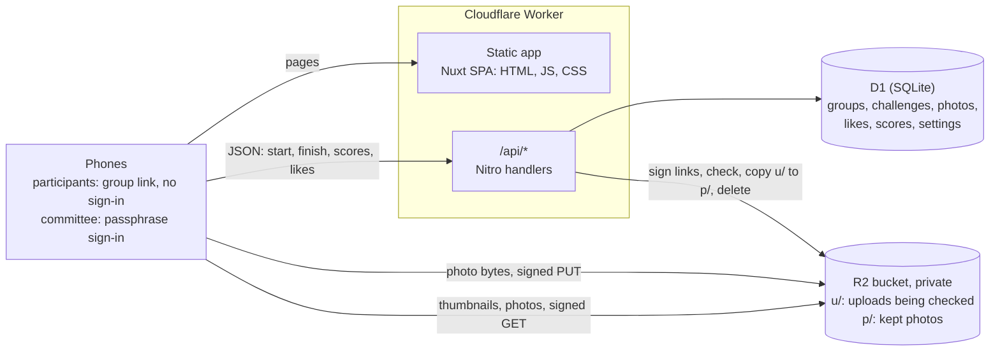
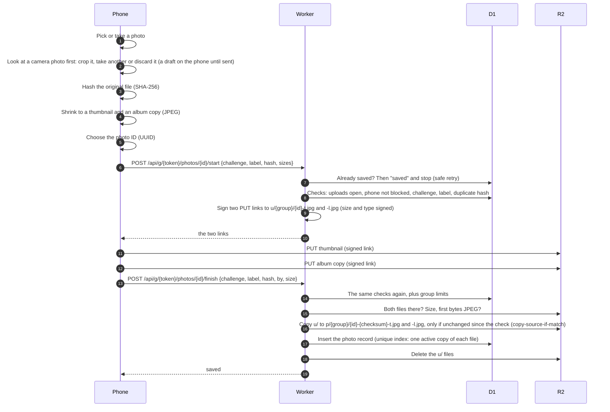
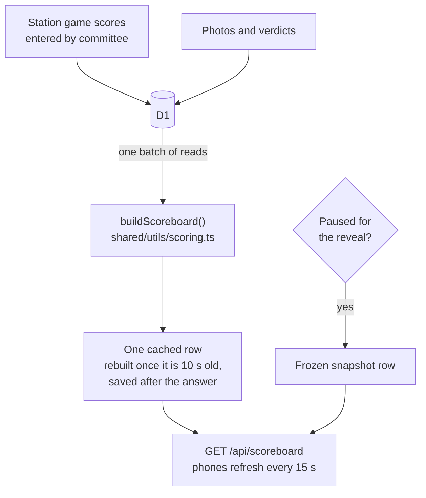
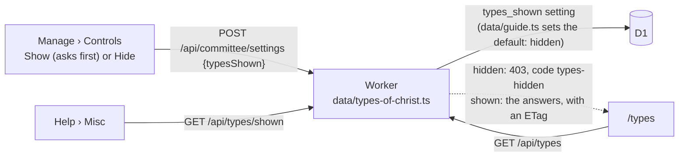
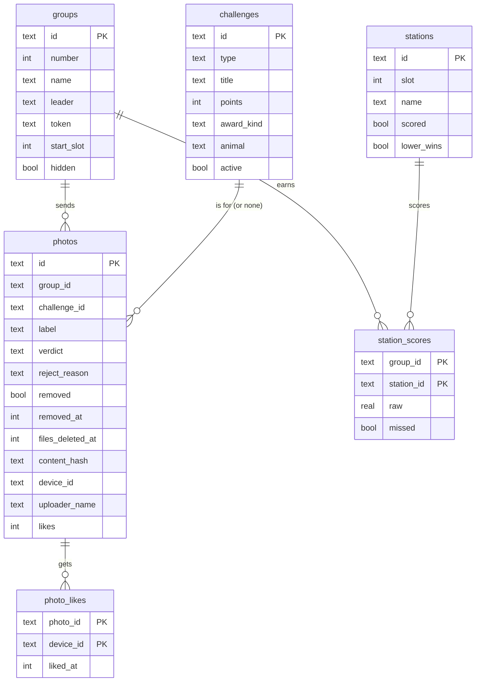
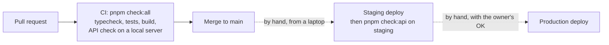

# Architecture

Photo Quest is a phone web app for one morning's outing. Groups send photos for challenges, the committee judges them and enters game scores, and everyone watches a live scoreboard. It's sized for about 50 people; this outing has about 30 in 5 groups.

Everything runs on Cloudflare: one Worker serves the app and its API, D1 (SQLite) holds the data, and R2 holds the photos. Photo bytes never pass through the Worker: phones send them straight to R2 with signed upload links and load them with signed view links. The diagrams below are Mermaid, so GitHub draws them.

## The pieces

- **App:** a Nuxt 4 single-page app (`ssr: false`), built to static files and served from the Worker's assets. Unknown paths fall back to `index.html`.
- **API:** Nitro event handlers in `server/api`, built with the `cloudflare_module` preset. They reach D1 through Drizzle (`server/db/schema.ts`) and R2 through the `PHOTOS` binding, plus R2's S3 API for signing upload links and copying inside the bucket (`server/utils/storage.ts`).
- **Photos:** the bucket stays private, with no public address. The API hands out signed view links (`usePhotoLinks` in `server/utils/storage.ts`), and phones load photos straight from R2. A link stays the same for `PHOTO_LINK_HOURS` (24, starting at midnight at the event, by `UTC_OFFSET` in `data/event.ts`) so phones cache the photo, is valid for twice that, and is signed once per period per Worker instance (up to `PHOTO_LINK_CACHE`, 5000, links remembered; 0 turns that off). A deleted photo stops loading at once for anyone who hasn't cached it, and a leaked link dies within two days. The `/img` route is shut whenever signed links are on, so a key read off a link can't be turned into one that lasts. The group page gets both links for each of its photos, like the gallery, since they open full size in the same photo view. Saving photos from the gallery (`app/composables/usePhotoSave.ts`) fetches the same view links from the page, so the bucket's CORS rule allows GET as well as PUT; the bytes still go straight from R2 to the phone. Signed links were chosen over a public bucket so the app can require sign-in later: the API would only hand links to signed-in people.
- **Gallery:** one list of every photo, newest first, the same for everyone (`server/api/gallery/index.get.ts`), with an ETag so an unchanged list comes back as 304. Newest means when the app kept the photo (`uploaded_at`, set by finish), not when it was taken, so a photo held on a phone without signal goes to the top once it sends. Anything that writes `uploaded_at` itself, like the staging and demo scripts, must never write a time later than now: such a photo sits above every photo sent after it. The phone filters, sorts (Newest or Most liked) and selects on it, and shows it a screenful at a time; what this phone liked or sent comes from `/api/gallery/mine`, keyed on its `x-device-id`: the hearts it filled in, and the photos the Group filter's My photos keeps (`?group=mine`; group IDs are `g1`, `g2`… and `recce`, so none is called that). `docs/caching.md` says why one list, what it costs, and when to page it instead. Signed-in committee members get Hide in its Select, and a Hidden photos page of their own (`/c/hidden`, from `/api/committee/photos/hidden`: photos taken out of the gallery with their files kept, never in the gallery's list, so nobody picking photos there can tick one). Both act on ticked photos through `/api/committee/photos/batch` (`app/composables/useCommitteeBatch.ts` on the phone): `remove` (Hide), `restore` (Unhide), or `delete` (for good, only photos already hidden). Hide can be undone; Delete can't. Each request takes up to 50 photos (`COMMITTEE_BATCH`, as D1 takes at most 100 values in a query) in a handful of queries however many there are (D1 allows 50 a request on the free plan), and is safe to retry. Hide's `done` lists only the photos that request hid, read back from the update itself (`RETURNING`), so an Undo puts back only what its own Hide took out, never a photo another committee member hid meanwhile. Unhide and Delete for good also count photos already in that state as done, so a retry reads as success, and Delete for good can finish the files of photos an earlier try marked. Everything else comes back in `refused` with why. The phone sends a bigger selection in turns, one action at a time. If storage fails twice after photos are marked for Delete for good, the request fails, logs `[files-left]` with their keys, and the phone keeps them in Hidden photos to try again; a retry deletes the files of photos already marked. Hidden photos lists the latest hidden first, by `removed_at`, which hiding sets and unhiding clears. Both answers build their photos with `useGalleryPhoto` and carry the groups and challenges from `galleryMeta` (`server/utils/gallery.ts`), which also holds `restorePhotos`, shared with the single-photo route.
- **Shared rules:** scoring and the round timetable are pure functions in `shared/utils`, used by the server, the pages and the tests.
- **Logs:** Workers Logs is on (`observability` in `wrangler.jsonc`). Each request's log has its method, URL, status and headers, so it can be counted by phone (`x-device-id`) and by address (`cf-connecting-ip`); unhandled errors add Nitro's `console.error` line. Each refused request (400 to 499) adds one line from `server/plugins/refusal-log.ts` with its refusal code, the message the phone was shown, the route pattern and the group (on a group's link, and on calls about one photo once it's found), so a refusal can be explained later. `scripts/watch-live.ts` prints a summary of the live app's requests each minute.

## Who can do what

| Who | How they're recognised | What they can do |
| --- | --- | --- |
| Anyone with the app link | Nothing | See the groups, the gallery, the scoreboard and the participant guide; like photos; read the Types of Christ answers once the committee shows them |
| A group | The group's token in its page URL (`/g/<token>`) | Send photos for that group, see its own photos and verdicts |
| One phone | A random ID kept in the browser's storage, sent as `x-device-id` | One like per photo; move or remove photos it sent itself; can be blocked from sending |
| Committee | A shared passphrase, then a sealed session cookie (nuxt-auth-utils) | Judge and move photos (one at a time, or many at once in the judge's grid), hide any photos (many at once from the gallery's Select), and unhide them or delete them for good from Hidden photos (`/c/hidden`), enter scores, set group ICs, move round times, close uploads, pause the scoreboard, show the Types of Christ answers, block phones |

The group links aren't secret from other participants: the home page lists every group so people can pick theirs. That's deliberate for a friendly event.

## Sending a photo

The phone does the heavy work. It shrinks each photo to a thumbnail and an album copy before sending. Then it asks the app to start: the app runs every check before any bytes move, so a refused photo sends nothing, and hands back two signed links valid for 15 minutes. The phone sends both files straight to R2, then asks the app to finish. The app checks what arrived and copies it, inside R2, to the photo's lasting key.

A queue keeps going when the person moves to another page, and retries when the signal comes back. Photos still to send are also saved in the browser's IndexedDB, so if the phone closes the tab in the background, they carry on sending the next time the app is opened, on any page. Each try asks for fresh links, so a saved photo never holds a link that has expired.

An animal or flower photo waiting for its name is a draft, kept in a second IndexedDB store (`drafts`, one per race and group, with the name typed so far), so closing the sheet or leaving the page doesn't lose it. The group page offers "Finish animal photo" until it's sent or discarded. A photo from "Take a photo" waits the same way while its challenge is chosen (one per group, kind `photo`, the choice in `pick`, `camera` when it came from the camera, so it can be taken again in place, and, once cropped, the photo as taken in `original` with the crop's `frame`); it enters the upload queue only on "Add to gallery".

A photo from a challenge's camera or a hidden group's camera is first shown full screen (`app/components/quest/ShotReview.vue`, one on the group page, so it outlives the challenge's sheet, laid out by `DraftScreen.vue`). A race's photo skips this: it goes straight to its race's draft and sheet, where naming it is the look before it goes, and its thumbnail opens the same `DraftScreen` with no buttons, to crop. The check's photo waits as a third kind of draft (`SHOT_DRAFT`, one per group, the challenge in `pick`), so "Retake", an app switch or a closed tab can't lose it; the strip offers "Finish Hornbill photo". Drafts store their photos as bytes (an ArrayBuffer with the type and name), not as Files, since Safari's IndexedDB won't always keep a File and fails without a word; the File is rebuilt on load, and drafts saved as Files before still load (`app/utils/queueStore.ts`). Send passes it to the queue and drops the draft; the X or Back asks, then drops it. It's on the phone only: nothing is hashed, queued or uploaded before Send, so the photo's ID is only chosen once it's accepted. The bottom bar's camera skips this, since its New photo sheet is already that look, with the same buttons. Photos chosen from the phone skip it too: they were seen in the picker. A camera photo's X always asks first; one from the phone just goes (`usePhotoDiscard` in `app/composables/usePhotoCheck.ts`).

Both can crop and rotate (`app/components/PhotoCrop.vue`, the frame's and rotation's rules in `app/utils/crop.ts`). Rotate turns the photo a quarter turn clockwise (counted in anticlockwise quarters, as `crop.ts` does); the frame is kept as fractions of the photo as turned, with the number of turns, and `cropPlan` maps it back to the photo as taken. `cropPhoto` in `app/utils/image.ts` decodes the photo as taken (turned by its EXIF, as `shrinkPhoto` does) and draws that area, turned, into a new JPEG of at most 2048 px at quality 0.92. A draft keeps the turns with its frame. That copy is what's queued: hashed, shrunk to the album copy and thumbnail with the usual quality and size rules, and sent like any photo. A crop still being made when cropping closes is dropped (`latestOnly`), so a late one can't replace the photo. It all happens on the phone; no new library.

- **Retries are safe:** the phone picks the photo ID, so sending the same photo again after a lost response finds the record and changes nothing.
- **Duplicates:** the hash of the original file is only accepted once. A second copy in the same group is refused with a way to reuse the first one. A copy from another group is refused outright.
- **Counting:** a photo counts as soon as it's saved. The committee only steps in when one doesn't match its challenge.
- **Kept photos can't change:** signed upload links only ever point at `u/` keys, and only the app writes `p/` keys (signed view links are GET-only). Each kept key includes part of the file's checksum, so a second finish for the same photo (two tabs, or a retry racing the first) writes beside the kept files instead of over them, and the photo record decides which version counts. R2 ignores "only if absent" on copies, so the checksum in the key is what makes this hold.
- **The same file once:** a unique index on the hash of active photos means two phones sending the same file at the same moment can't both get in. The loser is told the photo was already sent.
- **Abandoned uploads tidy themselves:** a lifecycle rule deletes anything under `u/` after a day, for phones that sent files but never finished.
- **Interrupted uploads:** if a file didn't arrive or changed, finish answers 409 and the phone starts that photo again with fresh links. Files go up with XMLHttpRequest so the phone can watch progress: an upload is abandoned only after 30 seconds without progress, so a slow but steady signal always finishes.
- **Setup problems show:** if storage or the app keeps refusing while there's signal (a missing key, an expired token, a wrong CORS rule), after three refusals spread over at least a minute the phone says "1 photo isn't sending · saved" with Retry instead of blaming the signal, and other pages show "1 stuck" in the top bar. People will tell the committee; there's no automatic alert.

Known gaps, accepted for a friendly event and worth closing in a reusable version:

- A finish that copies files and then fails before saving the record leaves unused files under `p/`. Only the sender knows their keys. The bucket's 120-day lifecycle rule removes them eventually; a sweep that lists `p/` keys with no record would remove them sooner.
- Start doesn't reserve anything, so a misbehaving phone could start many uploads it never finishes. The lifecycle rule clears them after a day, and the committee can block a phone.
- Group limits (400 photos, 200 just-a-photo) are checked before saving, not atomically. They're far above what a group sends in a morning.
- Likes are one per phone ID, and a phone ID is just a random value in the browser's storage, so clearing it gives another like. Since the Most liked photo award was dropped on 16 Nov 2026, likes only sort the gallery's Most liked tab, so stuffing them can lift a photo but can't change the scores. Accepted for a friendly event (decided 4 Nov 2026); sign-in would close it.

### Why signed links

The first version sent photo bytes through the Worker. It worked at this event's size, but each upload held its album copy in the Worker's memory until it finished. A Worker isolate has 128 MB, shared by every request it's serving at once, so 40 or more uploads in flight on one isolate would put it at risk. Every photo view was also a Worker request, counted against the free plan's 100,000 a day. Signed links take both off the Worker: it only handles small JSON requests, and R2 serves the bytes.

What it costs:

- **Two more pieces of setup:** an R2 API token per bucket (stored as Worker secrets), and the bucket rules below.
- **Checks after the fact:** the app can't look at bytes before they land, so finish checks the size and the JPEG header, and only then copies the file to its lasting key. Content-Length and Content-Type are part of each link's signature, so R2 itself refuses a file of the wrong size or type.
- **Same number of Worker requests per upload:** start and finish, as before the thumbnail and album copy. Photo views no longer reach the Worker at all.
- **No shared cache for views:** each phone's first view of a photo goes to R2 (a Class B read; 10 million a month are free). A public custom domain would add Cloudflare's cache, at the cost of making the bucket public; signed links were chosen so sign-in can be added later.

## Scores and the scoreboard

- Each station ranks the groups; first of five gets 5 points, times `RANK_SCALE` (60). The photo quest isn't ranked: its real photo points (10 to 80 a challenge) go straight into the total, so `RANK_SCALE` sets how much the stations weigh against it.
- Award races add a fixed bonus: most animals, most flower colours and most photos. Tied groups share an award. Likes don't count. Most liked photo was a fourth race until 16 Nov 2026 (`docs/app-plan.md`). A board saved before then still holds it, but the pages only list the three races, so it never shows. A board paused back then keeps that prize in its photo points.
- Station scores survive bad signal: a typed score is kept in the phone's localStorage with the version it replaces, and an app-wide queue (`useScoreQueue.ts`, started by a client plugin) retries it on reconnect and every 15 s, on any page. A save names the version it replaces, so a score someone else changed meanwhile comes back as a conflict to resolve, never an overwrite.
- Phones refresh only while the page is visible, so a pocketed phone costs nothing.
- An ask's time goes on trips to D1. The sums take under 2 ms for 300 photos. A cached answer is one query, for the paused and cached rows together. A rebuild adds one batch that reads groups, stations, scores, challenges and each photo's scoring columns at one moment. The Worker saves the new copy after the answer has gone (`waitUntil`). The answer's `Server-Timing` header says `frozen`, `cached` or `rebuilt`, with the server's time. `docs/caching.md` has the numbers.

## The guide and the Types of Christ

Help › Misc opens two pages of event content. The participant guide (`/guide`) is the morning's timeline and how scoring works, from `data/guide.ts`; it's part of the app's own files, so it shows without signal. Its station points chart (`StationPoints.vue`) is drawn from `GROUP_COUNT` and `RANK_SCALE`, so it follows the scoring rules.

The Types of Christ (`/types`) are the answers to the puzzle card, so they mustn't reach phones before the results. They live in `data/types-of-christ.ts`, which only the server imports (`tests/data.test.ts` fails if anything under `app/` or `shared/` does), and come only from `/api/types`:

- **Help** asks `/api/types/shown` (one settings row) and lists Types of Christ only once it's true. Before that there's no row at all.
- **The page** fetches the answers once. While hidden, the route refuses with `types-hidden` and `no-store`, so no copy is cached; once shown, the answers are the same for everyone (about 32 KB, 10 KB compressed) and come with an ETag. Hiding them again refuses even a phone that holds the old ETag.
- **Content:** each type's hint, how the hint matches and how it points to Christ, as the committee wrote them, with Bible references marked `[Rom 5:14](Romans 5:14)` (`shared/utils/typesOfChrist.ts`). A tapped reference shows its KJV verses, which come with the answers, in a sheet with a link to BibleGateway.

## Data

Also: `settings` (key and JSON value: uploads open, round start, the cached and frozen scoreboards, the briefing checklist, how photo times read, whether the Types of Christ are shown, and in demo mode its snapshot and last reset day), `blocked_devices` and `login_attempts`.

## Running it

- Smart Placement is on (`placement` in `wrangler.jsonc`), so Cloudflare may run the Worker near D1 rather than near the phone. The README's "Using it for your own event" explains why and what to check.
- From scratch, on a new Cloudflare account: `wrangler d1 create --location=<region nearest your venue>` a database and `wrangler r2 bucket create` a bucket for each environment, put their names and IDs in `wrangler.jsonc` (and `wrangler.staging.jsonc`), set the secrets and bucket rules below, then `pnpm db:migrate:remote`, `pnpm db:seed:remote` and `pnpm run deploy`.
- Local: `pnpm dev`, with D1 and R2 emulated by Wrangler. `nuxt dev` has no S3 endpoint, so `start` hands out links to a stand-in route on the app (`/api/dev-upload/*`, built apps answer 404) and photos load through `/img/*`. Everything else, the phone's side and the finish checks, is the same code as live. `node scripts/demo-data.ts` fills in a morning's worth of demo photos and scores.
- Local, with the real R2 code: `pnpm build`, then `wrangler dev` with the built config plus `local_dev.experimental_s3_credentials` on the bucket and the R2 vars pointing at `http://localhost:8787/cdn-cgi/local/r2/s3` and `/cdn-cgi/local/r2/public/<bucket>`. Wrangler's local R2 answers signed links and copies like R2 does.
- Tests: `pnpm typecheck`, `pnpm test` (scoring, timetable, the upload queue's rules and the view-link signer) and `pnpm check:api` (the API's rules end to end, against `pnpm dev` or staging). `AGENTS.md` lists what to run when.
- Group ICs: the committee sets them in the app (Manage, Groups tab), which rebuilds the group's name, "Group 1 (Adam)". `GROUP_LEADERS` in `data/event.ts` only names the groups in a fresh database; a later seed keeps names set in the app.
- Fewer groups: lower `GROUP_COUNT` in `data/event.ts` and reseed. The seed removes each group past it that has no photos, scores or blocked phones, and hides one that has (hidden groups keep their photos but leave the group list, the timetable and the scoreboard).
- Deploy: `pnpm db:migrate:remote` when the schema changed, then `pnpm run deploy`. A change to `r2/cors.production.json` goes on the bucket first (`wrangler r2 bucket cors set`), since the app relies on it. Seeding live is `APP_URL=https://<live address> pnpm db:seed:remote` (the address goes into the group links it prints).
- Staging: the same app with its own Worker, database and photo bucket, set in `wrangler.staging.jsonc`, for testing without touching the live event: `pnpm db:migrate:staging`, `pnpm db:seed:staging`, `pnpm run deploy:staging`. The deploy writes its own config next to the one Nitro generates and deploys with `-c`, so the default Wrangler config, and every production command, stays pointed at production. Staging uses signed view links like live.
- Secrets: `NUXT_COMMITTEE_PASSPHRASE`, `NUXT_APP_SECRET`, `R2_ACCESS_KEY_ID` and `R2_SECRET_ACCESS_KEY`, set with `wrangler secret put` (add `-c wrangler.staging.jsonc` for staging). The R2 keys come from an R2 API token with Object Read & Write on that one bucket; make a separate token per bucket, with an expiry date.
- Vars (in the wrangler configs): `R2_S3_ENDPOINT`, `R2_BUCKET_NAME`, `PHOTO_LINK_HOURS` and `PHOTO_LINK_CACHE`, and `DEMO_MODE` for a public demo only (see Demo mode).
- Bucket rules, set once per bucket with Wrangler:
  - CORS, so phones can PUT photos and GET them for saving, from the app's address: `wrangler r2 bucket cors set <bucket> --file r2/cors.production.json` (or `r2/cors.staging.json`).
  - Lifecycle, to clear abandoned uploads: `wrangler r2 bucket lifecycle add <bucket> uploads-in-progress u/ --expire-days 1`.
  - Lifecycle, to delete photos some months after the event (live uses 120 days, once the album is exported): `wrangler r2 bucket lifecycle add <bucket> delete-after-120-days --expire-days 120`.
  - Leave public access off (no custom domain, no `r2.dev`): photos are served by signed links.

## How changes travel, and where it's fragile

An honest rating, written after the outing. It held up on the day, but much of it rests on written rules that people and agents follow, not on the system.

| What moves | How | What can go wrong | Rating |
| --- | --- | --- | --- |
| Code | CI checks every push; deploys are run by hand from whatever checkout someone is in | Staging or live runs code that isn't on main, and nothing records which commit is deployed | Fragile |
| Schema | Numbered Drizzle migrations made per branch, applied by hand to each database, forward only | Two branches made in parallel pick the same number; a migration from an unmerged branch reaches the shared staging database. Both happened here | Fragile |
| Config | `wrangler.jsonc` is production, and it's the default for every Wrangler command; staging overrides only name, database, bucket and vars | Any command run without `-c wrangler.staging.jsonc` touches production | Risky default |
| Secrets and keys | Set by hand per Worker; R2 tokens can only be made by the account owner, and expire | When a token lapses, photos stop loading | Manual |
| Bucket rules | CORS and lifecycle as JSON files and commands, applied by hand | The bucket drifts from the files, or a new environment is set up without them | Manual |
| Test data | Seed scripts per environment; one shared staging | Several people or agents testing at once overwrite each other's data. That happened here | Shared |
| Photos | The phone picks the ID; start, signed PUT to `u/`, finish checks and copies to a write-once `p/` key | Little: retries are safe, a refused photo sends nothing, abandoned uploads expire | Solid |

Two more limits. Locally, `nuxt dev` uses a stand-in upload route, so signed links, CORS and in-bucket copies only run on staging (hence the AGENTS.md rule to check storage changes there). And R2 has no versioning, so Delete for good is final, as intended; D1's Time Travel can restore the database to an earlier point.

If you build on this for something longer-lived, change these first: make no environment the default (name it in every command), deploy from CI with the commit recorded, keep bucket rules and secrets in a provisioning script, warn before keys expire, run an S3-compatible server locally, and give each pull request its own environment once more than one person or agent works at a time. `.claude/skills/app-environments` has the checklist.

## Demo mode

A public copy of the app that strangers can try, committee pages included, without seeing each other's photos. It's off unless the Worker var `DEMO_MODE` is `"true"`. Locally, put `DEMO_MODE=true` in `.env`, which Wrangler reads for `pnpm dev`. With it off, none of this runs. The rules are in `server/utils/demo.ts` and `shared/utils/demo.ts`.

- **The seeded state.** `node scripts/demo-snapshot.ts` reads the local database, or a deployed one with `--remote -c <config>`, and keeps a snapshot in the `demo_seed` setting. It holds every photo's ID, verdict, reject reason, checked time, challenge, label, `removed` and `removed_at`, every like, every station score, the settings and each group's name and IC. Demo mode's own settings and the scoreboard cache stay out. Every photo in the snapshot is a showcase photo. Routes only write settings by fixed names, so no visitor can change `demo_seed` or `demo_reset_day`.
- **Who sees what.** Everyone sees the showcase. Any other photo shows only on the phone that sent it, by `x-device-id`. Every list and count adds the one condition `demoPhotos(event)` gives: the group page, the judge's queue, the committee home, Hidden photos, the briefing checklist's first photos, Animal names and their rename, and the CSV export. The committee's pages send `x-device-id` too, so a visitor judging sees their own photos. `/api/gallery` stays one answer for everyone, with its ETag, and holds the showcase only. `/api/gallery/mine` adds the phone's own photos in full, and the gallery merges them in, newest first, so they show under Everyone and My photos. It asks again on every look, so one removed or hidden elsewhere goes, and one sent from another tab arrives. The public scoreboard and its paused copy count the showcase only.
- **The limit.** The demo keeps at most 50 visitors' photos at once (`DEMO_PHOTO_LIMIT`), from every phone together, not counting ones deleted for good. Start and finish refuse the next one with `demo-full`, a 429 the phone shows as "The demo is full for today. Try again tomorrow."
- **Showcase photos can't be deleted for good.** `refuseShowcaseDelete` guards the judge's Delete and Inappropriate, a sender's removal, and the batch's Delete for good. The batch refuses all of its photos if any is a showcase photo, and the phone shows the reason. Visitors can do everything else, judging, hiding, moving, settings, scores, ICs and blocking phones included, since the reset undoes it.
- **The nightly reset.** The first API request after midnight at the event (`UTC_OFFSET`) moves the `demo_reset_day` setting to the new day with one conditional write. Only the request whose write changed it runs the reset; the others carry on. Each Worker instance checks at most once a minute. The reset deletes visitors' photos' files first. Then one batch deletes their rows and every like, puts back the showcase photos' fields, the likes, station scores, settings and group names, recounts each photo's likes, and clears blocked phones, sign-in failures and the scoreboard cache. A failed reset runs again a minute later, and every step is safe to run twice. Without a snapshot it does nothing. To reset by hand, set `demo_reset_day` to an earlier day.
- **The clock.** The demo runs after the event, so a page without `?at=` starts at `EVENT_DATE` and `DEMO_CLOCK` from `data/event.ts`, 10:12 am in round 2, and ticks on from when it loaded (`app/composables/useClock.ts`). `?at=` still wins. The server keeps real time. A photo's time is when it was really sent, and the scoreboard's "provisional" goes by the real date.
- **On screen.** `GET /api/demo` says whether this is the demo and, if it is, gives the committee passphrase, public on purpose. Pages ask it once through `useDemo`. The group page says "Demo: photos you send only show on this phone, and clear every night." Committee sign-in shows the passphrase.
