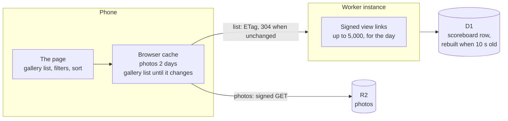

# Caching and scale

What gets kept where, for how long, and for whom; and what changes when an event has more people. The numbers were measured on 11 Nov 2026 (staging, from Singapore, and locally) unless marked as estimates. `docs/architecture.md` covers how the pieces fit; this file covers what each piece costs.

## The short version

- **Photos** are the heavy part, and each phone keeps every photo it has seen for two days. There's no shared cache: each phone's first view of a photo comes from R2.
- **The gallery** is one list of every photo, the same for everyone. A phone loads it once, then filters, sorts and selects on the phone, and checks for changes every 30 seconds. An unchanged list costs a few hundred bytes (304).
- **The scoreboard** is worked out at most once every 10 seconds and kept in one database row that every phone reads.
- **Nothing is cached between phones on Cloudflare's network.** At 50 phones it isn't needed. The section on scale says when it would be.

## Where things are kept

| What | Size | Kept where, for how long | Asked for |
| --- | --- | --- | --- |
| A thumbnail (400 px) | 25–55 KB | Each phone's browser, 2 days (`private, max-age=172800, immutable`) | When it scrolls near the screen |
| An album copy (2048 px) | up to 3 MB | Each phone's browser, 2 days | When the photo is opened or saved |
| The gallery list (`/api/gallery`) | about 1.3 KB a photo as JSON, 100–170 bytes compressed | The page, plus the browser's cache with an ETag (`private, no-cache`) | On opening the gallery, then every 30 s while it's on screen |
| This phone's likes and photos (`/api/gallery/mine`) | tens of bytes | The page | On opening the gallery, and when new photos arrive (in demo mode, every 30 s, as it holds the visitor's photos) |
| The Types of Christ answers (`/api/types`), once shown | about 32 KB as JSON, 10 KB compressed | The page, plus the browser's cache with an ETag (`private, no-cache`); a refusal while hidden is `no-store` | On opening the page |
| Whether they're shown (`/api/types/shown`) | tens of bytes | Not kept (`no-store`) | On opening Help |
| The scoreboard | about 3.5 KB | One D1 row, rebuilt when 10 s old; the phone asks every 15 s | While the scoreboard is on screen |
| A signed view link | about 500 bytes | Each Worker instance, for the day (`PHOTO_LINK_CACHE`, 5,000 links) | Whenever a list includes the photo |

### Photos

- **Each link stays the same for the day.** A signed link is the same all day (`PHOTO_LINK_HOURS`, from midnight at the event), and R2 answers with `Cache-Control: private, max-age=172800, immutable`. Once a phone has a photo, it never asks again that day.
- **First views are slow.** There's no cache in front of R2, because signed links don't go through Cloudflare's CDN. Measured from Singapore, with the bucket in APAC: one thumbnail takes about 0.45 s to its first byte, and 24 at once finish in about 1.2 s. That, plus the old per-filter request, is why a group's photos took a moment to appear the first time.
- **The shared CDN cache would need a public bucket.** A public bucket on a custom domain would let Cloudflare keep photos near the phones and share them between phones. Signed links were chosen instead, so sign-in can be added later (`docs/app-plan.md`).

### The gallery list

- **Why one list.** The gallery used to come 48 photos at a time, sorted by likes, with each filter a new request. That broke in three ways:
  - Likes reorder photos between pages, so a photo could be skipped or shown twice.
  - The "new photos" check only looked at the first 48, so once 48 photos had a like, new ones never showed up there.
  - Every filter change waited on the network.
- **How it works now.** The list is small next to the photos: the whole gallery costs less than one screenful of thumbnails. So the phone loads all of it once, and filters, the Newest / Most liked sort and Select all happen on the phone.
- **The order stays put.** The order is fixed when the list settles: when it loads, when a filter or the sort changes, or when "N new photos" is tapped. Like counts update in place without moving anything.
- **It's the same answer for everyone.** What a phone liked or sent comes from `/api/gallery/mine`, so the list itself can be shared:
  - The browser checks it with an ETag. Cloudflare turns the tag weak (`W/"…"`) when it compresses; the server ignores that.
  - The list carries how photo times read (Manage › Controls), so changing that changes the ETag: every phone fetches the whole list once more (about 130 KB at 800 photos), then 304s again.
  - A shared cache can be added later without changing the phone's side.
- **The cost at 800 photos.** These are estimates from local tests and the staging list's per-photo size:
  - About 1 MB of JSON, 85–135 KB compressed.
  - About 2 ms to build and hash on the server.
  - About 35 ms to sign every link on a fresh Worker instance.
  - The phone parses it in tens of milliseconds.

### The scoreboard

- **Trips to D1 are the cost.** Working out the board takes under 2 ms for 300 photos. A trip from the live Worker to D1 takes about a tenth of a second from Singapore, and a write takes longer. Both are estimates from the live timings that follow. On 14 Nov, with 335 photos, a rebuild took 1.1 to 2.4 s, while a route with one query took 0.2 s. The rebuild made four trips one after another. It read the paused row, then the cached row, then the board's data, and then waited for the new copy to save.
- **Now one or two trips.** A cached answer reads the paused and cached rows in one query, 3 rows. A rebuild adds one batch of six reads (round start included), about 380 rows at 300 photos. The Worker saves the copy after the answer has gone (`waitUntil`), so no phone waits for the write; the phone that triggered a rebuild still waits for its reads.
- **Measured locally** with 300 photos, 300 likes and 25 scores. With every D1 trip slowed by 100 ms to stand in for live, a rebuild went from about 480 ms to 280 ms and a cached answer from 220 ms to 110 ms. Without the slowdown both were already quick, about 50 ms and 7 ms.
- **Overlaps.** Requests that arrive while a rebuild is under way each rebuild and save, a batch of reads and a write each. The copy is stamped with when it was read, and a save never replaces a newer copy with an older one, so the board doesn't step back. One gap is left: a save still under way when the committee resumes a paused board can bring back a copy up to 10 seconds old, until the next rebuild.
- **Checking it on live.** `curl -s -D - -o /dev/null <app>/api/scoreboard` shows `server-timing: cached;dur=…` or `rebuilt;dur=…`, the server's own time in milliseconds.

## Scale

Assumptions: about 16 photos per person (800 for this event's 50), everyone watching the gallery at once (results time), and each phone checking the list every 30 seconds. D1 counts the rows it scans, and each list request scans every photo plus about 50 rows of groups and challenges.

| People | Photos | Gallery list, compressed | List requests a minute | D1 rows read an hour | Signing on a fresh instance |
| --- | --- | --- | --- | --- | --- |
| 50 | 800 | 85–135 KB | 100 | about 5 million | about 35 ms |
| 150 | 2,400 | 250–400 KB | 300 | about 45 million | about 110 ms |
| 500 | 8,000 | 0.8–1.3 MB | 1,000 | about 480 million | about 350 ms, and over the 5,000-link cache |

Against Cloudflare's plans:

- **Workers Paid** (this event, until 3 Dec 2026) includes 25 billion D1 rows read and 10 million requests a month. All three rows fit for a morning.
- **Workers Free** allows 5 million D1 rows read and 100,000 requests a day. At 50 people, an hour of everyone watching the gallery uses the day's reads. Requests are fine.
- **Photos** cost the same on either plan. Each phone's first view of each photo is one R2 read (10 million a month are free), and R2 doesn't charge for bandwidth.

What to change, and when:

1. **On Workers Free, at any size**, cache the list between phones so the 30-second checks don't each read every photo. The simplest fit is the scoreboard's pattern: keep the built list (without links, which each request signs from its own cache) in one D1 row, rebuilt when it's 10 seconds old. The catch is that a photo someone has just sent can take up to 10 seconds to appear, even for its sender.
2. **Past about 2,500 photos**, raise `PHOTO_LINK_CACHE` (each link is about 500 bytes of Worker memory), or sign links only for the photos on screen.
3. **Past about 3,000 photos**, the first load gets slow on a weak signal (half a megabyte or more), and Lighthouse starts calling the page heavy. Then page the list again:
   - For Newest, by a cursor on (upload time, ID). New photos only add to the top, so nothing is skipped.
   - For Most liked, freeze the ordered list of IDs when it loads and fetch the photos for them a screenful at a time.
   - Filters then go back to the server.
4. **Past about 5,000 photos on one screen**, older phones run short of memory for decoded thumbnails. Remove rows far above and below the screen and keep their height, as Google Photos and Immich do.

## Not cached on purpose

- **Station scores and judging:** these always read and write the database directly, because a stale score or verdict is worse than a slow one.
- **The group page:** each phone asks for its own group's page. Its thumbnail and full-size links come from the same link cache as the gallery's, since its photos open full size too.
